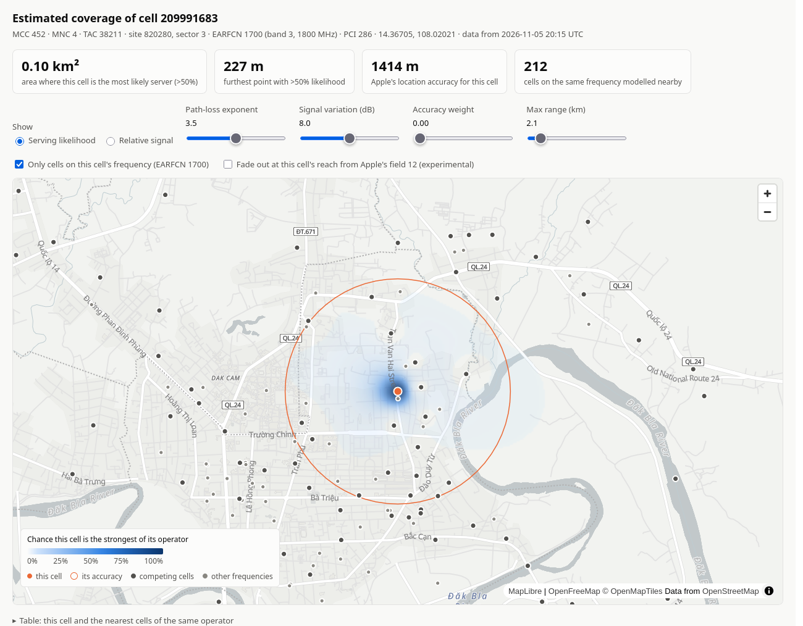
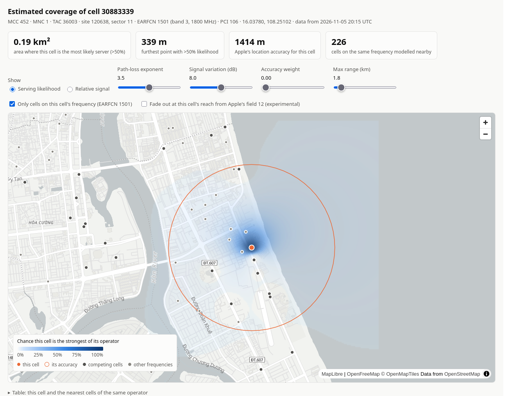
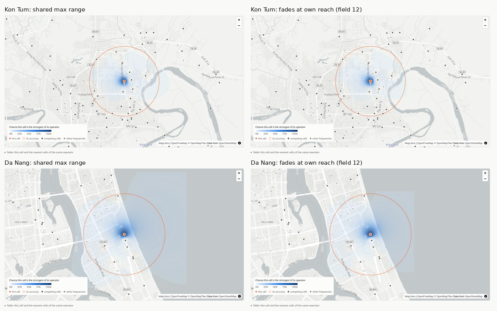
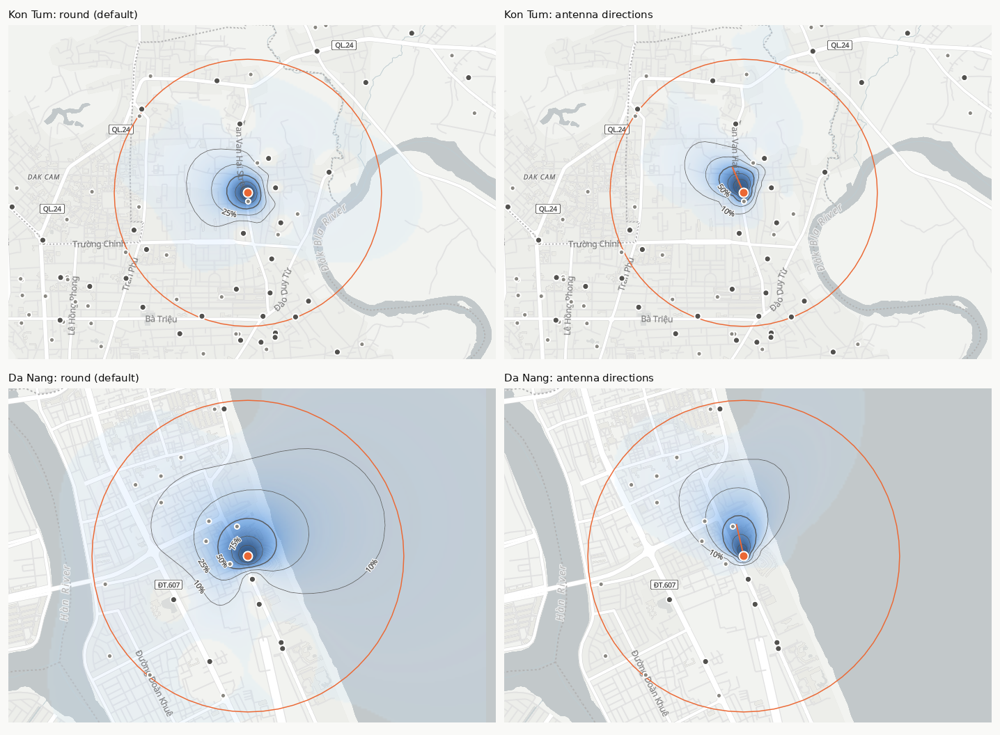
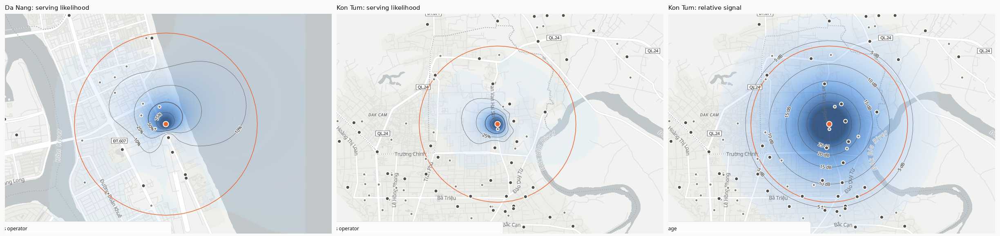
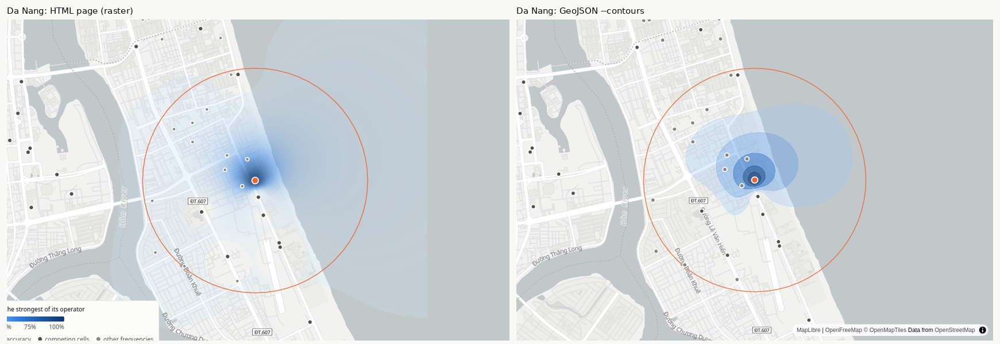

# Examples

Coverage estimates for two LTE cells in Vietnam, generated with `wtfps heatmap` from cells crawled with `wtfps explore cell` on 2026-11-05. The last section compares the default model with the experimental field 12 option. Each cell has an interactive HTML map, the same data as GeoJSON, and a screenshot of the map.

| Cell | Operator | Place | Frequency | Area where most likely server |
|---|---|---|---|---|
| `452 4 38211 209991683` | MNC 4 (Viettel) | Kon Tum, inland town | EARFCN 1700 (band 3, 1800 MHz) | 0.10 km² |
| `452 1 36003 30883339` | MNC 1 (MobiFone) | Da Nang, on the coast | EARFCN 1501 (band 3, 1800 MHz) | 0.19 km² |

## Kon Tum: `cell-452-4-38211-209991683`



- [`cell-452-4-38211-209991683.html`](cell-452-4-38211-209991683.html): open in a browser for the interactive map.
- [`cell-452-4-38211-209991683.geojson`](cell-452-4-38211-209991683.geojson): the cell, its accuracy circle, 332 nearby cells and the modelled coverage hexagons.

Sector 3 of site 820280. Same-frequency cells are about 500 m apart here, so the cell is the most likely server only within about 200 m. Sector 9 of the same site, 87 m away, is on band 1 with the same PCI (286): very likely the same antenna direction on another frequency layer, so it doesn't compete.

## Da Nang: `cell-452-1-36003-30883339`



- [`cell-452-1-36003-30883339.html`](cell-452-1-36003-30883339.html): open in a browser for the interactive map.
- [`cell-452-1-36003-30883339.geojson`](cell-452-1-36003-30883339.geojson): the cell, its accuracy circle, 460 nearby cells and the modelled coverage hexagons.

Sector 11 of site 120638, by the beach. There are no competing cells out at sea, so the model spreads its coverage over the water until it fades out at the maximum range; the straight edge on the right of the map is where the modelled area ends. Real coverage at sea is unknown: Apple only knows cells that iPhones have seen. The field 12 option below limits this spread.

## Comparison: fading out at the cell's own reach (field 12)



Apple's replies include an undocumented location field (field 12, stored as `unknown_12`). Across 3,000 crawled cells it grows with the spacing between cells, from a median of about 1.9 km where same-frequency cells are under 385 m apart to 6.4 km where they're over 1.4 km apart, so it behaves like each cell's reach. Its meaning is a guess.

By default the model fades every cell out at one shared maximum range (at the time these figures were made 4× the typical cell spacing; now Okumura–Hata's radius for the cell's band, which only changes the faint outer fringe). The experimental option (the checkbox on the map, or `--use-unknown-12` with `--geojson`) fades the cell out at its own field 12 reach instead:

| Cell | Fades out at | Area where most likely server | Furthest point above 50% |
|---|---|---|---|
| Kon Tum, default | 2,143 m (shared range) | 0.103 km² | 226 m |
| Kon Tum, field 12 | 1,066 m | 0.103 km² | 225 m |
| Da Nang, default | 1,796 m (shared range) | 0.192 km² | 341 m |
| Da Nang, field 12 | 637 m | 0.168 km² | 310 m |

- **Kon Tum**: neighbouring cells already bound the core on every side, so only the faint outer fringe shrinks.
- **Da Nang**: with nothing to stop it at sea, the default model spreads the cell over the water. Its field 12 reach is only 637 m, so the coverage pulls back towards the shore.

Using field 12 as each cell's *strength* was tried first and rejected: a few cells have values above 40 km, and treated as strength they outshout nearby cells everywhere, so the Kon Tum cell vanished entirely. The option therefore only uses the cell's own value, for where it fades out; competition between cells stays distance-based.

## Antenna directions



By default each cell's coverage is round. With "Antenna directions" ticked on the map (or `--directional` with `--geojson`), sectors get a sector antenna's wedge-shaped pattern (65° beamwidth, 20 dB front-to-back), pointing from their site's centre towards the sector's position; the orange line shows this cell's direction.

| Cell | Direction | Round: area / reach | Wedge: area / reach |
|---|---|---|---|
| Kon Tum | 336° | 0.103 km² / 226 m | 0.103 km² / 316 m |
| Da Nang | 347° | 0.192 km² / 341 m | 0.095 km² / 373 m |

The Kon Tum site shows the idea working: its three band-3 sectors come out at 102°, 222° and 336°, almost exactly 120° apart, and the band-1 sector sharing sector 3's PCI gets the same 336°. Across 16,894 crawled three-sector sites the estimate is much rougher: half have their three directions within 150° of evenly spread, against 29% for random positions treated the same way, so there is a real signal but plenty of noise. That's why it's off by default.

For slides, [`antenna/`](antenna/README.md) has 16:9 images of three cells in every mode (propagation model × frequency mode × round or antenna directions), with an overview per cell.

## Contour lines on the HTML map



The HTML maps draw contour lines over the heat: 10, 25, 50, 75 and 90% likelihood, or every 5 dB in the relative signal view. The thicker 50% line is where the cell becomes the most likely server. The lines follow the sliders, and the "Contour lines" checkbox hides them.

## Contour bands



[`cell-452-1-36003-30883339-contours.geojson`](cell-452-1-36003-30883339-contours.geojson) is the Da Nang cell written with `--contours`: smooth likelihood bands (10–25%, 25–50%, 50–75%, 75–90% and 90–100%) instead of hexagons, at about a third of the size. The bands at 50% and above add up to 0.193 km², matching the 0.192 km² summary. The faint haze over the sea on the HTML map is below 10%, so it has no band; `--contour-levels 0.02,0.1,0.25,0.5,0.75,0.9` adds one.

## Viewing

- **HTML**: open the file in any browser. It needs internet access for the map library and the basemap; the cell data is inside the file. Sliders change the model live; hover anywhere for the values at that spot.
- **GeoJSON**: geojson.io and GitHub's map preview colour the coverage hexagons automatically from their `fill` / `fill-opacity` properties. In QGIS, style the `role = 'coverage'` features by `likelihood`. Uploading a file to a website shares its contents with that site.

## What the model is

An estimate, not a measurement. Each cell's position is Apple's estimate of where the cell is used, not the tower. Signal is modelled as falling off with distance, and a phone is assumed to use the strongest cell on its frequency, allowing for random variation from buildings and terrain. By default it doesn't model antenna directions, so each sector's area comes out roughly round; the [antenna directions](#antenna-directions) option estimates them, roughly. See the [`heatmap` section of the main README](../README.md#heatmap) for the fields and options.

## Regenerating

With the crawled database in `DATABASE_URL`:

```sh
wtfps heatmap 452 4 38211 209991683 --out examples/cell-452-4-38211-209991683.html
wtfps heatmap 452 4 38211 209991683 --geojson --out examples/cell-452-4-38211-209991683.geojson
wtfps heatmap 452 1 36003 30883339 --out examples/cell-452-1-36003-30883339.html
wtfps heatmap 452 1 36003 30883339 --geojson --out examples/cell-452-1-36003-30883339.geojson
```

Add `--use-unknown-12` to the `--geojson` commands for the field 12 variant.

```sh
wtfps heatmap 452 1 36003 30883339 --geojson --contours --out examples/cell-452-1-36003-30883339-contours.geojson
```

The results change as the crawler finds more cells and fills in their frequencies.
