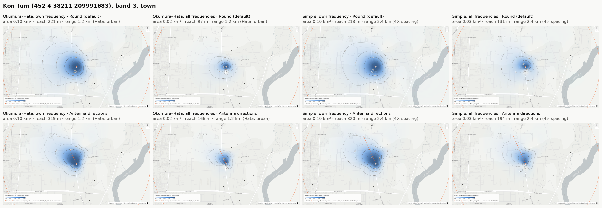
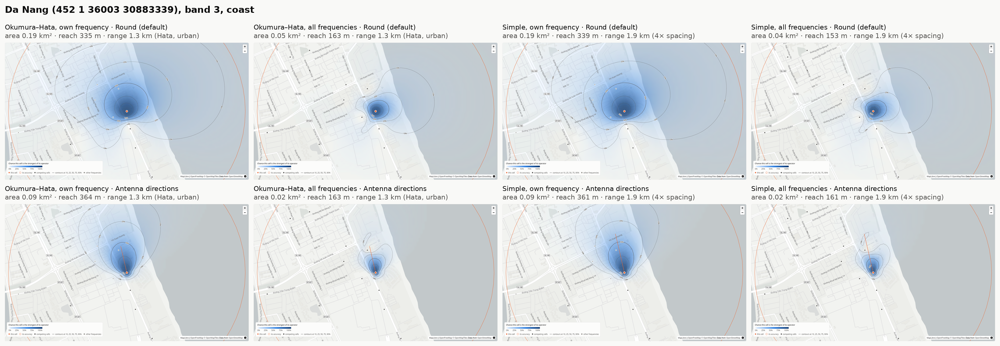
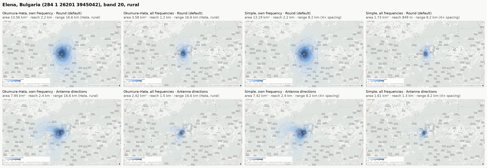

# Antenna direction comparisons

Slide-ready images (1600 × 900, 16:9) of three cells, each in every mode: both propagation models × both frequency modes × round coverage and antenna directions. Each cell's eight images share the same view, so they can be flipped through on consecutive slides. `*-overview.png` puts all eight side by side with labels (3280 × 1136).

Generated on 2026-11-08 with `wtfps heatmap` from the crawled database, then captured from the HTML map with each mode set through the map's own controls (one zoom step closer than the map opens, centred on the cell). Figures are the map's own: **area** where the cell is the most likely server (likelihood above 50%), **reach** the furthest such point, **range** where signal fades out.

| Mode | What changes |
|---|---|
| Okumura–Hata / Simple | the propagation model: Hata makes lower frequencies carry further and takes the range from Hata's radius for the band and environment; Simple uses distance only and 4× the cell spacing. See [docs/propagation-models.md](../../docs/propagation-models.md). |
| Own frequency / All frequencies | whether the cell only competes with cells on its own EARFCN (the default) or with every cell of its operator |
| Round / Antenna directions | sectors as round, or with a sector antenna's wedge-shaped pattern pointing from their site's centre towards their position (a rough estimate; the orange line shows this cell's direction) |

## Kon Tum (452 4 38211 209991683), band 3, town

| Image | Propagation | Frequencies | Antenna | Area | Reach | Range |
|---|---|---|---|---|---|---|
| [`kon-tum-hata-own-frequency-round.png`](kon-tum-hata-own-frequency-round.png) | Okumura–Hata | own | round | 0.10 km² | 221 m | 1.2 km (Hata, urban) |
| [`kon-tum-hata-own-frequency-directional.png`](kon-tum-hata-own-frequency-directional.png) | Okumura–Hata | own | directions | 0.10 km² | 319 m | 1.2 km (Hata, urban) |
| [`kon-tum-hata-all-frequency-round.png`](kon-tum-hata-all-frequency-round.png) | Okumura–Hata | all | round | 0.02 km² | 97 m | 1.2 km (Hata, urban) |
| [`kon-tum-hata-all-frequency-directional.png`](kon-tum-hata-all-frequency-directional.png) | Okumura–Hata | all | directions | 0.02 km² | 166 m | 1.2 km (Hata, urban) |
| [`kon-tum-simple-own-frequency-round.png`](kon-tum-simple-own-frequency-round.png) | Simple | own | round | 0.10 km² | 213 m | 2.4 km (4× spacing) |
| [`kon-tum-simple-own-frequency-directional.png`](kon-tum-simple-own-frequency-directional.png) | Simple | own | directions | 0.10 km² | 320 m | 2.4 km (4× spacing) |
| [`kon-tum-simple-all-frequency-round.png`](kon-tum-simple-all-frequency-round.png) | Simple | all | round | 0.03 km² | 131 m | 2.4 km (4× spacing) |
| [`kon-tum-simple-all-frequency-directional.png`](kon-tum-simple-all-frequency-directional.png) | Simple | all | directions | 0.03 km² | 194 m | 2.4 km (4× spacing) |

## Da Nang (452 1 36003 30883339), band 3, coast

| Image | Propagation | Frequencies | Antenna | Area | Reach | Range |
|---|---|---|---|---|---|---|
| [`da-nang-hata-own-frequency-round.png`](da-nang-hata-own-frequency-round.png) | Okumura–Hata | own | round | 0.19 km² | 335 m | 1.3 km (Hata, urban) |
| [`da-nang-hata-own-frequency-directional.png`](da-nang-hata-own-frequency-directional.png) | Okumura–Hata | own | directions | 0.09 km² | 364 m | 1.3 km (Hata, urban) |
| [`da-nang-hata-all-frequency-round.png`](da-nang-hata-all-frequency-round.png) | Okumura–Hata | all | round | 0.05 km² | 163 m | 1.3 km (Hata, urban) |
| [`da-nang-hata-all-frequency-directional.png`](da-nang-hata-all-frequency-directional.png) | Okumura–Hata | all | directions | 0.02 km² | 163 m | 1.3 km (Hata, urban) |
| [`da-nang-simple-own-frequency-round.png`](da-nang-simple-own-frequency-round.png) | Simple | own | round | 0.19 km² | 339 m | 1.9 km (4× spacing) |
| [`da-nang-simple-own-frequency-directional.png`](da-nang-simple-own-frequency-directional.png) | Simple | own | directions | 0.09 km² | 361 m | 1.9 km (4× spacing) |
| [`da-nang-simple-all-frequency-round.png`](da-nang-simple-all-frequency-round.png) | Simple | all | round | 0.04 km² | 153 m | 1.9 km (4× spacing) |
| [`da-nang-simple-all-frequency-directional.png`](da-nang-simple-all-frequency-directional.png) | Simple | all | directions | 0.02 km² | 161 m | 1.9 km (4× spacing) |

## Elena, Bulgaria (284 1 26201 3945042), band 20, rural

| Image | Propagation | Frequencies | Antenna | Area | Reach | Range |
|---|---|---|---|---|---|---|
| [`elena-hata-own-frequency-round.png`](elena-hata-own-frequency-round.png) | Okumura–Hata | own | round | 13.56 km² | 2.2 km | 16.6 km (Hata, rural) |
| [`elena-hata-own-frequency-directional.png`](elena-hata-own-frequency-directional.png) | Okumura–Hata | own | directions | 7.94 km² | 2.4 km | 16.6 km (Hata, rural) |
| [`elena-hata-all-frequency-round.png`](elena-hata-all-frequency-round.png) | Okumura–Hata | all | round | 3.58 km² | 1.2 km | 16.6 km (Hata, rural) |
| [`elena-hata-all-frequency-directional.png`](elena-hata-all-frequency-directional.png) | Okumura–Hata | all | directions | 2.42 km² | 1.5 km | 16.6 km (Hata, rural) |
| [`elena-simple-own-frequency-round.png`](elena-simple-own-frequency-round.png) | Simple | own | round | 13.19 km² | 2.2 km | 8.2 km (4× spacing) |
| [`elena-simple-own-frequency-directional.png`](elena-simple-own-frequency-directional.png) | Simple | own | directions | 7.42 km² | 2.4 km | 8.2 km (4× spacing) |
| [`elena-simple-all-frequency-round.png`](elena-simple-all-frequency-round.png) | Simple | all | round | 1.73 km² | 849 m | 8.2 km (4× spacing) |
| [`elena-simple-all-frequency-directional.png`](elena-simple-all-frequency-directional.png) | Simple | all | directions | 1.61 km² | 1.3 km | 8.2 km (4× spacing) |

## What they show

- **Antenna directions turn round coverage into a wedge** that reaches further in the antenna's direction and gives up area behind it: the Elena cell's area drops from 13.56 to 7.94 km² while its reach grows from 2.2 to 2.4 km; Da Nang's halves (0.19 → 0.09 km²) as its coverage becomes a narrow strip along the beach.
- **The propagation model barely matters on the cell's own frequency**: the core is set by competing cells, so the areas are nearly the same (Kon Tum 0.10 km² in both). It matters with every frequency competing, where Okumura–Hata gives the 800 MHz Elena cell its advantage over higher bands (3.58 against 1.73 km², round).
- **With every frequency competing the areas shrink** in every mode, because other frequency layers' cells compete too.

The directions are rough estimates (see [antenna directions](../README.md#antenna-directions)), and every figure is a model, not a measurement. The figures will change as the crawl adds cells.
